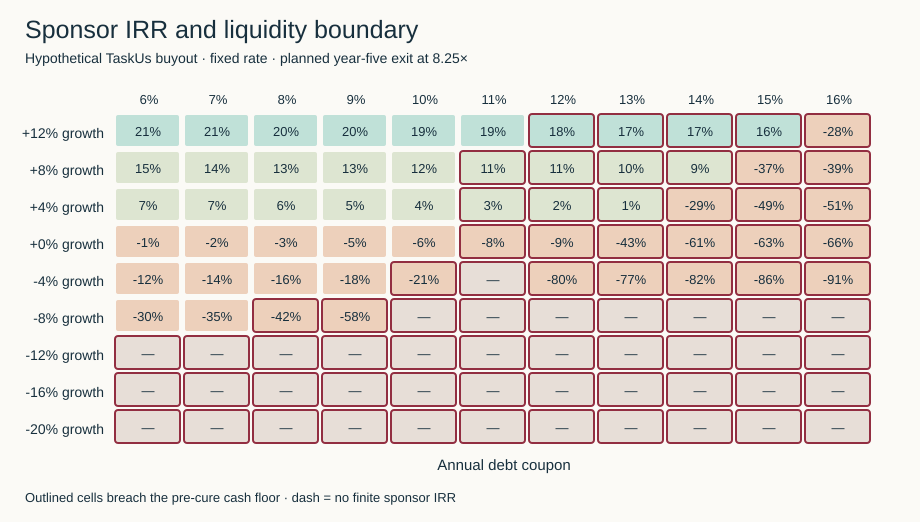

# LBO return attribution

A hypothetical TaskUs buyout anchored to its FY2024 filing earned **16.29% sponsor IRR and 2.13× MOIC** in the base case, with no multiple expansion. The downside case earned **−26.55% and 0.24×**. The severe case breached its equity cure cap and left zero to the sponsor.



[Sponsor bridge](report/bridge.svg) · [Annual cash and debt waterfall](report/waterfall.csv) · [Results and hand check](RESULTS.md)

## Reproduce

Use Python 3.11 or newer. No external dependencies.

```sh
git clone https://github.com/NeilMeher/lbo-return-attribution.git
cd lbo-return-attribution
python -m unittest -v
python study.py --quick --output pilot
python study.py
```

The run rebuilds sources and uses, sponsor cash flows, return attribution and financing stress cases. The [historical input ledger](historical.csv) is hand-entered from the [FY2024 SEC filing](https://www.sec.gov/Archives/edgar/data/1829864/000182986425000016/task-20241231.htm) and requires no outside download. All entry, debt, growth and exit terms in this study are hypothetical.

See [protocol](PROTOCOL.md), [sources](SOURCES.md), and [experiment log](EXPERIMENT.md). Neil Meher commissioned the study and defined verification requirements. Codex assembled the baseline, implemented the model and ran the checks. Neil’s independent review is pending.
